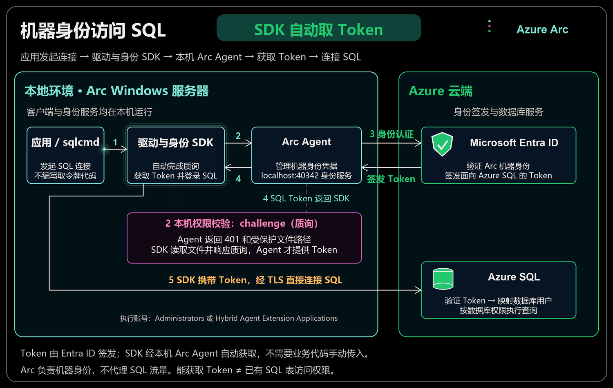
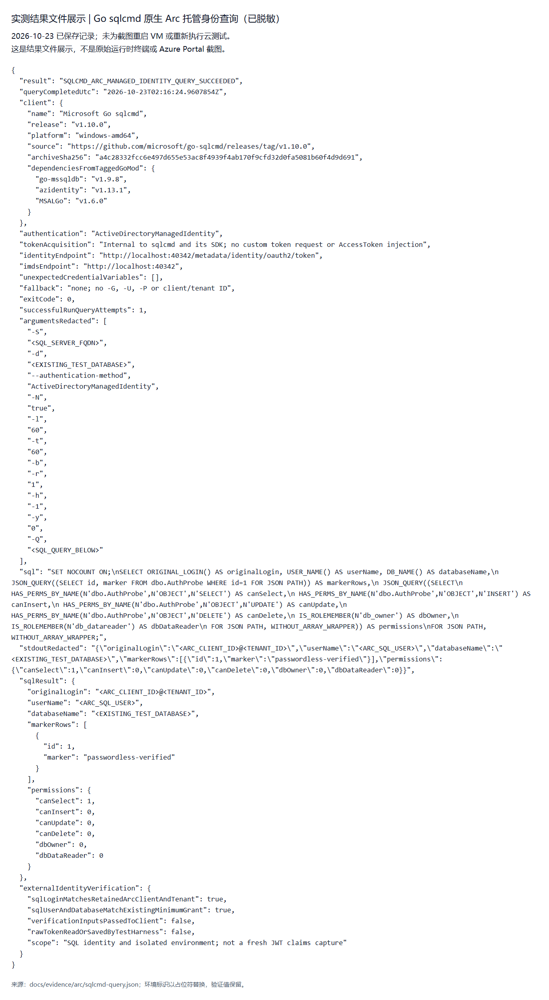

# 使用 Azure Arc 托管身份访问 Azure SQL

让本地 Windows 服务器以 **Arc 机器身份**访问 Azure SQL，无需在应用中保存 SQL 密码或应用 secret。本文使用已实测成功的 **Microsoft Go sqlcmd v1.10.0**，由客户端自动获取 Token，不需要自写 Token 脚本。

这不是 Windows 用户 SSO；用户登录方案见 [WAM 示例](README.md)。

## 1. 方案与前提



[静态图](docs/images/arc-sql-auth-flow.png) · [可编辑 Excalidraw 源文件](docs/images/arc-sql-auth-flow.excalidraw)

应用发起连接后，**本机驱动与身份 SDK** 自动完成质询，向 Arc Agent 获取 **云端 Entra ID 签发的 Token**，再携带 Token 经 TLS 直连 Azure SQL。**Arc 不代理 SQL 流量**；能获取 Token 与是否具有 SQL 表权限是两层独立授权。

| 前提 | 要求 |
| --- | --- |
| 机器与租户 | Windows 已接入 Azure Arc；本文要求 Arc 身份与 SQL 位于同一 Entra 租户，订阅可以不同 |
| 本地执行权限 | 程序在 Arc 机器上运行；执行账号属于本地 Administrators 或 `Hybrid Agent Extension Applications` 组 |
| SQL 管理权限 | 已配置 SQL Entra 管理员；由有权限的管理员创建数据库用户、授予表级 SELECT |
| 客户端支持 | 必须支持 **Arc 托管身份端点与 challenge**，不能只凭“支持 Azure VM MI”判断兼容 |
| 网络 | 允许 Arc／Entra 必需出站、SQL TCP1433 及连接策略要求的附加端口；使用有效 TLS 证书 |

**身份关系：** Arc 接入后自动获得系统分配托管身份，无需另建客户端应用注册。管理员只负责接入和首次 SQL 授权；应用运行时不需要管理员登录或 `az login`。

> 本例曾用独立 Azure VM 模拟本地 Windows，完成原生 IMDS 隔离后验证，**仅供评估**。生产 Azure VM 应使用原生托管身份，不应照搬此隔离方案。

## 2. 将 Windows 接入 Arc，取得身份信息

在 **Azure Portal → Azure Arc → Machines → Add/Create → Add a machine → Add a single server**，选择 SQL 所在租户中的目标订阅、资源组、区域和 Windows，按生成的官方流程安装并接入。

在机器上检查：

```powershell
& "$env:ProgramFiles\AzureConnectedMachineAgent\azcmagent.exe" show --json
```

确认状态为 `Connected`，然后核对以下两个标识：

| 标识 | Portal 获取位置 | 用途 |
| --- | --- | --- |
| **Principal ID / Object ID** | Arc 机器 → Overview → JSON View → `identity.principalId` | 识别 Arc 对应的 Entra 服务主体 |
| **Application ID / Client ID** | 同租户 Entra ID → Enterprise applications → 按上述 Object ID 找到机器应用 → Overview／Properties | 本文 SQL 用户 SID 映射使用此值 |

Arc 资源类型应为 `Microsoft.HybridCompute/machines`，身份类型为 `SystemAssigned`。**不要将 Principal ID 与 Client ID 混用，也不要误取底层 Azure VM 的身份。**

<details>
<summary>Portal 位置截图：Arc 状态、身份 JSON、企业应用</summary>


以上为真实 Portal 脱敏截图，采集时评估机已停机，所以显示 Offline／Disconnected；运行时 Connected 记录见[隔离验证证据](docs/evidence/arc/isolation.json)。

</details>

## 3. 配置 SQL 网络和最小权限

### 3.1 网络与管理员

在 **SQL server → Microsoft Entra ID** 确认已配置管理员；无需将 Arc 身份设为服务器管理员，也无需仅为此方案更改现有 SQL 认证模式。

在 **SQL server → Networking** 配置机器到 SQL 的网络：

- 公网方案：仅允许 **Arc 机器实际出口 IP**，防火墙 Start IP 与 End IP 相同；不是浏览器所在工作站的 IP。
- 私网方案：准备 Private Endpoint、路由和 Private DNS。本例实测为公网单 IP，未验证私网。

不需要开放所有 IP 或启用 “Allow Azure services and resources to access this server”。

<details>
<summary>Portal 位置截图：Entra 管理员与 SQL 防火墙</summary>


截图中的服务器原本已启用仅 Entra 认证；这不是本方案必须新开的设置。环境标识已遮盖。

</details>

### 3.2 创建数据库用户

以下示例使用已有测试表 `dbo.AuthProbe`。先由管理员在**目标数据库，而非 master** 核对表及数据；业务环境替换为需要访问的表，不必创建同名测试表。

```sql
SELECT id, marker FROM dbo.AuthProbe WHERE id = 1;
```

在 PowerShell 中用第 2 节核对的 **Arc Client ID** 计算 SQL SID：

```powershell
$sid = '0x' + [BitConverter]::ToString(
    ([guid]'<ARC_CLIENT_ID>').ToByteArray()
).Replace('-', '')
$sid
```

由 SQL 管理员将输出替换下方 `<ARC_CLIENT_ID_HEX_SID>`，在目标数据库执行：

```sql
CREATE USER [arc-sql-reader] WITH SID = <ARC_CLIENT_ID_HEX_SID>, TYPE = E;
GRANT SELECT ON OBJECT::dbo.AuthProbe TO [arc-sql-reader];
```

`arc-sql-reader` 是数据库内自定义别名。用户已存在时，先核对 `sys.database_principals` 中的 SID 和类型是否匹配，不盲目重建。此方式由管理员负责准确核对身份，**不给 db_owner、db_datareader，也不以 Azure IAM 角色代替 SQL 数据权限**。

## 4. 在 Arc 机器上用 sqlcmd 查询

### 4.1 准备客户端

从[微软官方 release](https://github.com/microsoft/go-sqlcmd/releases/tag/v1.10.0)下载 **Go sqlcmd v1.10.0 Windows AMD64** 便携版，校验后解压。不要与 ODBC 版 sqlcmd 混用。本次官方 ZIP 的 SHA256：

```text
a4c28332fcc6e497d655e53ac8f4939f4ab170f9cfd32d0fa5081b60f4d9d691
```

运行 `.\sqlcmd.exe --version` 确认版本，`.\sqlcmd.exe -?` 查看 SQL 查询选项。本次验证组合为 go-mssqldb 1.9.8、azidentity 1.13.1、MSALGo 1.6.0，其他版本／客户端需另行核实 Arc 支持。

在 **Arc 机器本机**的新会话中，检查 Agent 提供的环境变量：

```powershell
$env:IDENTITY_ENDPOINT  # http://localhost:40342/metadata/identity/oauth2/token
$env:IMDS_ENDPOINT      # http://localhost:40342
```

它们用于发现本机 Arc 身份端点，不是待填写的身份 ID。若缺失或指向其他地址，先检查 Agent 和会话环境。确认没有意外的 `SQLCMDUSER`、`SQLCMDPASSWORD`、`SQLCMDCLIENTID` 或其他 Azure 用户／应用凭据变量。

### 4.2 执行查询

替换 SQL 地址和数据库名，在具有第 1 节本地权限的会话中运行：

```powershell
.\sqlcmd.exe -S '<SQL_SERVER_FQDN>' -d '<DATABASE_NAME>' `
  --authentication-method ActiveDirectoryManagedIdentity `
  -N true -l 60 -t 60 -b -r 1 `
  -Q "SET NOCOUNT ON; SELECT ORIGINAL_LOGIN() AS LoginIdentity, USER_NAME() AS DatabaseUser, DB_NAME() AS DatabaseName; SELECT id, marker FROM dbo.AuthProbe WHERE id=1;"
if ($LASTEXITCODE -ne 0) { throw 'sqlcmd query failed.' }
```

**不填用户名、密码、Tenant ID 或 Client ID，不需要自写 Token 脚本。** `-N true` 要求加密；不加 `-C`，保留证书验证。这里不使用 `-G`，因为 Go sqlcmd 在无用户名密码时的 `-G` 可走默认凭据链，不能保证仅走指定 MI 路径。

成功后应看到目标数据库、Arc 数据库用户以及预期表数据。将上述 `-Q` 的内容替换为以下 SQL，可用同一身份检查权限：

```sql
SELECT
  HAS_PERMS_BY_NAME(N'dbo.AuthProbe', N'OBJECT', N'SELECT') AS CanSelect,
  HAS_PERMS_BY_NAME(N'dbo.AuthProbe', N'OBJECT', N'INSERT') AS CanInsert,
  HAS_PERMS_BY_NAME(N'dbo.AuthProbe', N'OBJECT', N'UPDATE') AS CanUpdate,
  HAS_PERMS_BY_NAME(N'dbo.AuthProbe', N'OBJECT', N'DELETE') AS CanDelete,
  IS_ROLEMEMBER(N'db_owner') AS DbOwner,
  IS_ROLEMEMBER(N'db_datareader') AS DbDataReader;
```

本例预期只有 `CanSelect=1`，其余为 `0`。

## 5. 实测结果

**2026-10-23，官方 Go sqlcmd v1.10.0 在 Arc Windows 机器内查询成功，退出码为 0。**

| 验证项 | 结果 |
| --- | --- |
| 认证方式 | `ActiveDirectoryManagedIdentity`，客户端内部获取 Token，无自写 Token 或用户登录回退 |
| SQL 身份 | `ORIGINAL_LOGIN()` 匹配 `<ARC_CLIENT_ID>@<TENANT_ID>`；数据库用户为既有 Arc 最小用户 |
| 数据 | `dbo.AuthProbe` 返回 1 行，marker 为 `passwordless-verified` |
| 权限 | SELECT=1；INSERT／UPDATE／DELETE=0；db_owner／db_datareader=0 |
| 身份隔离 | 查询前后 Arc Connected；无原生 VM MI，Guest Agent 停用，两处原生 IMDS 均无 HTTP 响应 |



图片是**真实执行记录的脱敏页面截图，不是原始终端或 GUI 截图**。[完整命令、SQL 与 stdout](docs/evidence/arc/sqlcmd-query.json) · [收尾截图](docs/images/arc-sqlcmd-final-state.png) · [收尾记录](docs/evidence/arc/sqlcmd-final-state.json)。

评估机已于当日北京时间 **10:17:19 解除分配**，临时 RDP 规则已移除，SQL 仍保留单 IP 规则；磁盘、公网 IP、SQL 和已启用的安全服务仍可能计费。此前 GUI 尝试未完成，**不将本次结果视为 DBeaver／JDBC 实测通过**。

## 6. 常见问题

| 问题 | 说明与处理 |
| --- | --- |
| 是否需要 Windows Entra 登录、PRT 或 `az login`？ | 不需要。SQL 使用 Arc 机器身份，但本地进程仍需有读取 Arc challenge 的权限。 |
| 是否每次重启都要接入 Arc？ | 正常重启后 Agent 自动恢复，无需重复 `azcmagent connect`；重装、断开接入或身份材料损坏另行处理。 |
| 换 JDBC／GUI 客户端能直接用吗？ | 必须核对驱动版本、身份 SDK 依赖与 Arc 支持。JDBC 的 `authentication=ActiveDirectoryManagedIdentity;` 是连接属性，不是 sqlcmd 参数；不能仅凭此属性证明兼容。 |
| Arc Connected，但 SQL 登录失败 | Connected 只证明接入成功。检查目标数据库、同租户身份、Client ID 到 SQL SID 的映射、SQL 网络及数据库权限。 |
| 无法读取 challenge／Access denied | 检查执行账号的本地组权限；不要广泛放开 Arc Tokens 目录 ACL。 |
| SQL 提示 `40613` 或数据库暂不可用 | Serverless 可能正在唤醒，对明确瞬态错误有限重试；认证、证书和授权错误不能当作瞬态错误忽略。 |
| SQL 连接超时或证书错误 | 核查机器真实出口 IP、DNS、1433／连接策略端口和证书链；不要靠开放所有 IP 或跳过 TLS 校验解决。 |
| 应用必须自行获取 Token 吗？ | 不必。本文 sqlcmd 自动处理；需要显式 Token 示例时可参考 [Test-ArcSql.ps1](scripts/Test-ArcSql.ps1)，该脚本是另一条已验证路径。 |

## 附：仅用 Azure VM 模拟本地机时

真实本地服务器跳过本节。专用 Azure 评估 VM 须按[官方评估指南](https://learn.microsoft.com/en-us/azure/azure-arc/servers/plan-evaluate-on-azure-virtual-machine)隔离原生能力，不能对业务 VM 直接操作：

1. 先验证不依赖 Guest Agent 的管理通道，并安排隔离失败时的恢复手段；停用后不能依赖 RunCommand。
2. 核对原生 VM 身份与扩展，按审批及官方步骤处理，避免与 Arc 身份混用。
3. 设置 `MSFT_ARC_TEST=true`，停用 `WindowsAzureGuestAgent`，用来宾出站防火墙阻断 `169.254.169.254` 与 `169.254.169.253`。
4. 再接入 Arc；查询前后验证身份未混用、两个原生 IMDS 均无 HTTP 响应。完成测试后解除分配评估 VM。

本例 Compute 与 Arc／SQL 分属不同租户；**最终身份属于 Arc／SQL 所在租户**，不是底层 VM 的托管身份跨租户访问 SQL。

## 参考

[Arc 托管身份与本机权限](https://learn.microsoft.com/en-us/azure/azure-arc/servers/managed-identity-authentication) · [Go sqlcmd 认证](https://learn.microsoft.com/en-us/sql/tools/sqlcmd/sqlcmd-authentication?view=sql-server-ver17) · [SQL 用户 SID 映射](https://learn.microsoft.com/en-us/sql/t-sql/statements/create-user-transact-sql?view=azuresqldb-current) · [SQL 网络要求](https://learn.microsoft.com/en-us/azure/azure-sql/database/connectivity-architecture?view=azuresql) · [全部脱敏证据](docs/evidence/arc)
