# 示例：使用 Azure Arc 托管身份访问 Azure SQL

在 Windows 上安装 Azure Connected Machine Agent，由本机程序向 Arc 身份端点申请 SQL 访问令牌，再通过 `SqlConnection.AccessToken` 连接 Azure SQL。**SQL 登录代表这台 Arc 机器，不是 Windows 登录用户；不使用 WAM，也不要求程序保存 SQL 密码或应用 secret。**

本例于 **2026-10-22** 完成真实查询：`SELECT ORIGINAL_LOGIN(), USER_NAME(), DB_NAME()`，并读取既有 `dbo.AuthProbe` 的 `passwordless-verified`。原 [WAM README](README.md) 保持不变；本文是另一条身份路径。

> **适用边界：** Arc 面向本地／其他云的机器。本例使用独立 Azure VM 模拟本地 Windows，按微软官方流程隔离原生 Azure 管理能力，**仅供评估测试，不是 Azure VM 的生产部署建议**。正常 Azure VM 应优先使用原生托管身份。本次没有为文档重新开机或重跑查询。

## 要求与身份边界

| 要求 | 本例配置与边界 |
| --- | --- |
| Windows 与执行身份 | Windows 11 Enterprise x64；本次从管理员 SSH 会话运行 PowerShell。获取 Arc Token 需要本地 Administrators 或 `Hybrid Agent Extension Applications` 组权限；不依赖 Windows Entra 登录／PRT。 |
| 机器身份 | 使用 `Microsoft.HybridCompute/machines` 的**系统分配托管身份**。它与 `Microsoft.Compute/virtualMachines` 的原生 VM 身份不是同一主体。 |
| 订阅与租户 | Compute 在订阅 A／租户 A；**Arc 资源和 SQL 在订阅 B／租户 B**。Token 由租户 B 签发；这不是把租户 A 的托管身份直接跨租户授权给 SQL。 |
| 应用注册 | 此路径不需要另建 WAM 公共客户端、Broker redirect URI 或 `user_impersonation` 委托同意；Arc 接入时自动建立其系统身份对应的服务主体。 |
| 接入凭据与运行凭据 | 接入 Arc、创建 SQL 用户是管理员引导工作，需要各自管理权限；最终 SQL 查询**不使用这些管理员 Token**，仅使用本机 Arc Token。 |
| SQL 权限 | SQL Entra 管理员创建与 Arc 身份匹配的数据库用户，只授予 `SELECT ON OBJECT::dbo.AuthProbe`；不给 `db_owner`、`db_datareader` 或服务器管理员。Azure RBAC 角色不能代替 SQL 数据权限。 |
| 网络与 TLS | 管理通道、Arc／Entra 出站与 SQL 网络分别准备；SQL 使用 TCP 1433，并满足连接策略的附加端口要求。`Encrypt=True`、`TrustServerCertificate=False`。 |
| 失败行为 | Arc challenge、Token 身份、TLS、用户映射或查询失败即失败；不回退到用户 WAM、Azure CLI、原生 VM MI、SQL 密码或交互登录。 |

### 与原 WAM 示例的区别

| 对比项 | [WAM 用户 SSO](README.md) | 本文 Arc 机器身份 |
| --- | --- | --- |
| 谁在登录 SQL | 当前 Windows Entra 用户 | Arc 机器的系统分配托管身份 |
| Token 获取 | MSAL Broker／WAM | 本机 `localhost:40342` Arc 端点 |
| Windows 用户登录／PRT | 是该示例前提 | 不是本路径前提 |
| 自编客户端应用注册 | 需要配置或复用公共客户端 | 不需要另建公共客户端 |
| SQL 授权对象 | Entra 用户／组 | Arc 身份对应的服务主体 |
| 本次有效数据库权限 | 原 WAM 实测用户为管理员，文档建议最小 SELECT | **已实际验证仅目标表 SELECT** |

## 调用链路与实现机制

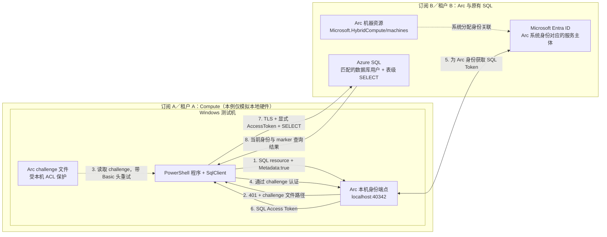

这是机制示意，不是运行截图。**SQL 请求直接从程序发给 SQL，不经过云端 Arc 资源代理。** Arc Agent 管理系统身份及其凭据，程序不读取 Agent 身份证书或私钥。读取的是官方 Token 流程返回的本地 challenge 文件，不是 Windows PRT、用户密码或其他私人凭据。

1. **一次性准备：** 管理员将机器接入 SQL 所在租户的 Arc，核对 Arc 主体，在数据库内配置最小授权及网络。
2. **本机请求：** 程序向 Arc 端点请求 `resource=https://database.windows.net/`；首次收到 401，按返回路径读取受保护的 challenge，携带 `Authorization: Basic <challenge>` 重试。不要对 challenge 额外做 Base64，也不要打印它。
3. **身份核对：** 取得 Token 后检查 SQL audience、`tid`、`oid`、`appid`／`azp` 与预期 Arc 身份一致。解码 claims 本身不等于密码学验签；实际令牌有效性仍由 Azure SQL 验证。
4. **数据库查询：** 设置 `SqlConnection.AccessToken`，执行身份、marker 和有效权限查询。成功后清理内存引用；应用不保存原始 Token。

## 1. 客户端与管理通道准备

### 1.1 准备独立评估机器

| 配置项 | 本次实测值 |
| --- | --- |
| 区域 | Southeast Asia（东南亚） |
| Windows | Windows 11 Enterprise 25H2，x64 |
| VM | `Standard_B2ls_v2`，2 vCPU／4 GiB |
| OS 磁盘 | 128 GiB，Standard SSD |
| 安全配置 | Trusted Launch、Secure Boot、vTPM |
| 原生 VM 身份／扩展 | 接入前为空；查询结束后再次核对仍为空 |
| 本机查询驱动 | Windows PowerShell 的 `System.Data.SqlClient` |

在 Portal 的 **Virtual machines → 测试机 → Overview／Configuration／Identity／Extensions + applications** 核对规格、身份和扩展。仅使用专用评估机，不修改现有业务机或 WAM 实验机。

**不要把部署 VM 的租户当成最终 SQL 身份租户。** 接下来填写的 Arc Tenant／Subscription 必须指向 SQL 所在租户及计划中的 Arc 订阅。本次复用已有 SQL，没有新建数据库，也没有更换 SQL Entra 管理员。

### 1.2 先验证不依赖 Guest Agent 的管理通道

本次使用 key-only OpenSSH TCP443，并固定服务器主机公钥：

```powershell
ssh -p 443 -i '<SSH_PRIVATE_KEY_PATH>' `
  -o StrictHostKeyChecking=yes `
  -o UserKnownHostsFile='<PINNED_KNOWN_HOSTS_PATH>' `
  '<LOCAL_ADMIN>@<VM_PUBLIC_IP>'
```

主机公钥应从已经信任的管理通道核对，而不是首次连接时盲目信任。实际完成了**两次独立登录及同一证据文件回收**，然后才停用 Guest Agent。

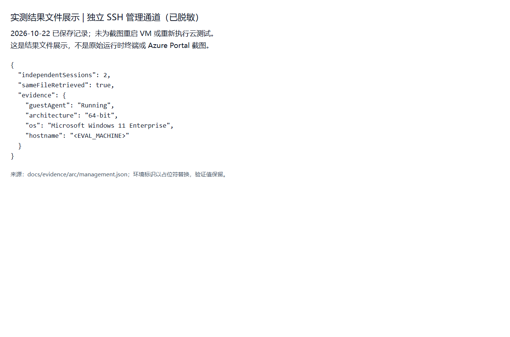

[对应脱敏 JSON](docs/evidence/arc/management.json)

**网络例外说明：** 本次最初使用工作站 `/32`，遇 SSH 来源限制后，经用户单独批准，仅将新机 TCP443 的 NSG／来宾防火墙来源改为 Any。**没有开放所有端口，也没有放宽 SQL 到所有 IP。** 这只是本次实验保留的例外；客户复现时优先使用受限来源、VPN 等批准通道，不把 Any 当作必需配置。图中的 Guest Agent `Running` 是**隔离前**的管理通道验证状态。

### 1.3 安排故障恢复

停用 Guest Agent 前，本次建立了 **30 分钟后以 SYSTEM 执行的本机恢复任务**。仅在管理失联时恢复本轮修改的两个 IMDS 防火墙规则及 Guest Agent，并写出恢复触发标记。

只有接入后再次通过独立 SSH、确认 Arc Connected 且恢复未触发，才撤销任务。**任务若触发，不能继续宣称原生身份隔离验证成功。** 禁用 Guest Agent 后，不依赖 Azure VM RunCommand 或 VM 扩展继续管理。

## 2. 隔离 Azure VM 原生能力并接入 Arc

> 以下隔离步骤**仅针对用 Azure VM 模拟本地机器的评估场景**。真实本地机器通常不需要这组 Azure VM 特有改动。执行前按 [官方评估指南](https://learn.microsoft.com/en-us/azure/azure-arc/servers/plan-evaluate-on-azure-virtual-machine)核对，尤其不能对现有业务机直接复制执行。

### 2.1 核对原生身份和扩展

在管理工作站、明确指定 Compute 订阅，只读检查：

```powershell
az vm show --subscription '<COMPUTE_SUBSCRIPTION_ID>' `
  --resource-group '<VM_RESOURCE_GROUP>' --name '<EVAL_MACHINE>' `
  --query '{identity:identity,security:securityProfile}'
az vm extension list --subscription '<COMPUTE_SUBSCRIPTION_ID>' `
  --resource-group '<VM_RESOURCE_GROUP>' --vm-name '<EVAL_MACHINE>'
```

本次新机没有配置原生 VM 托管身份，也没有待卸载扩展。若客户机器已有扩展，应先审批并按官方步骤卸载；若已有原生身份，先解决身份隔离方案，不能擅自移除现有业务身份。

### 2.2 设置评估标志、停用 Guest Agent、阻断原生 IMDS

从已验证的管理通道进入**新评估机的管理员 PowerShell**，先确认步骤 1.3 的恢复机制就绪：

```powershell
[Environment]::SetEnvironmentVariable('MSFT_ARC_TEST', 'true', 'Machine')
$env:MSFT_ARC_TEST = 'true'

Set-Service WindowsAzureGuestAgent -StartupType Disabled
Stop-Service WindowsAzureGuestAgent -Force

New-NetFirewallRule -Name ArcEvaluationBlockAzureIMDS `
  -DisplayName 'Arc evaluation: block Azure IMDS' `
  -Enabled True -Profile Any -Direction Outbound -Action Block `
  -RemoteAddress 169.254.169.254
New-NetFirewallRule -Name ArcEvaluationBlockLocalIMDS `
  -DisplayName 'Arc evaluation: block Azure Local IMDS' `
  -Enabled True -Profile Any -Direction Outbound -Action Block `
  -RemoteAddress 169.254.169.253
```

已有同名规则时先核对，不能盲目重复创建。除检查规则外，还需验证两个原生端点均不能返回 HTTP 响应；仅查看规则存在不能证明隔离有效。本次在真实 SQL 查询后再次验证了这一点。

### 2.3 安装并注册 Azure Connected Machine Agent

在 **Azure Portal → Azure Arc → Machines → Add/Create → Add a machine → Add a single server**，选择 **SQL 所在租户 B** 中批准的 Arc 订阅、资源组、区域与 Windows，参考生成的安装流程。接入执行者需要目标范围的 Arc 接入权限；此权限不是机器将来访问 SQL 的数据权限。

本次使用 [微软官方下载入口](https://aka.ms/AzureConnectedMachineAgent)取得 MSI，检查 Authenticode 签名为有效的 Microsoft Corporation 后静默安装，随后执行 `azcmagent connect`。

**本次接入凭据方式：** 管理工作站取得目标租户的短期 ARM Token，经固定主机公钥的 SSH／SFTP 传入**仅 Administrators 和 SYSTEM 可读的临时目录**，使用官方 `--config` JSON 接口；配置字段为 `access-token`。Token 不放进命令行参数、公共脚本、仓库或截图。输入文件读取后立即删除，Agent 使用的配置文件在命令结束的 `finally` 中删除。曾尝试的 stdin／named pipe 传输没有成功，**不是最终成功步骤**。

```powershell
$agent = Join-Path $env:ProgramFiles 'AzureConnectedMachineAgent\azcmagent.exe'
$configPath = '<ADMIN_SYSTEM_ONLY_TEMP_CONFIG_PATH>'
try {
    & $agent connect --config $configPath `
      --subscription-id '<ARC_SUBSCRIPTION_ID>' `
      --resource-group '<ARC_RESOURCE_GROUP>' `
      --tenant-id '<SQL_AND_ARC_TENANT_ID>' `
      --location southeastasia --resource-name '<ARC_MACHINE_NAME>' --no-color
    if ($LASTEXITCODE -ne 0) { throw 'Arc enrollment failed.' }
} finally {
    if (Test-Path -LiteralPath $configPath) {
        Remove-Item -LiteralPath $configPath -Force
    }
}
```

这里的占位符不是可用凭据；临时配置应由组织批准的安全引导过程创建并验证 ACL。**不要把 Token 粘进命令行、写进文档，或让缺少凭据的命令隐式回退到交互登录。** 客户也可选择官方其他接入认证方式，但必须明确区分“一次性接入认证”和“最终 SQL 运行时认证”。

### 2.4 核对 Connected 和独立系统身份

本机执行：

```powershell
& "$env:ProgramFiles\AzureConnectedMachineAgent\azcmagent.exe" show --json
```

Arc 机器成功接入时会自动建立**系统分配托管身份**，不需要像 Azure VM 一样另开 Identity 开关。本次 Portal 的 Arc 机器菜单没有独立 Identity 页，按以下路径核对：

1. 打开 **Azure Arc → Machines → 目标机器 → Overview**，查看 Status；展开 Essentials，点击右侧 **JSON View**。
2. 在 **Resource JSON** 中找到 `identity`，确认 `type = SystemAssigned`，记录 `principalId` 和 `tenantId`；资源 `type` 应为 `Microsoft.HybridCompute/machines`，不是 Compute VM。
3. 切到 **Arc 所在的 Microsoft Entra 租户 → Enterprise applications → All applications**，必要时将 Application type 过滤为 **Managed identities**，按机器名查找并用 Object ID 精确核对。打开对应应用的 **Overview → Properties**，读取 Application ID 和 Object ID。**Object ID 对应 Arc principalId，Application ID 才是本例需要的 Client ID。**

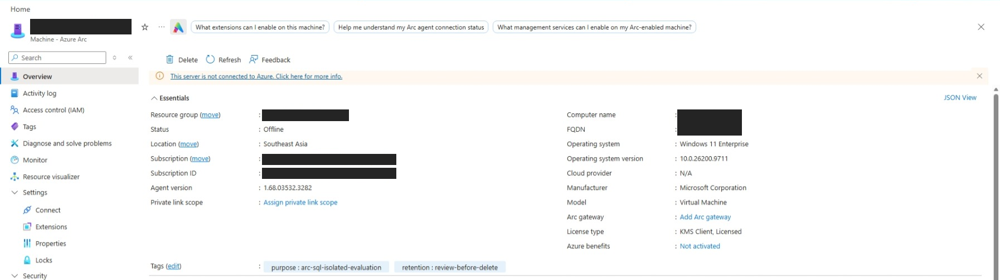

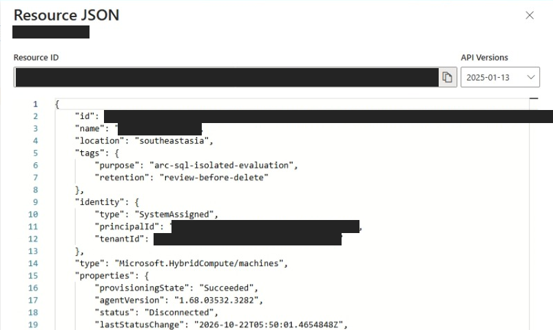

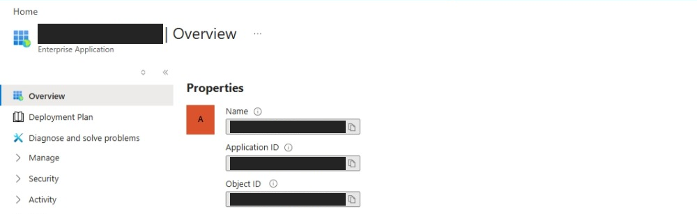

**以上三张是真实 Portal UI 脱敏截图，采集于实验成功且 VM 解除分配之后**，所以 Overview 显示 `Offline`，JSON 显示 `Disconnected`；没有为补图开机，也没有把状态改画成 Connected。运行时 Connected 的证据见本节下方实测结果。黑色遮盖隐藏环境标识，不是 Portal 默认显示内容。企业应用页面仅用于核对身份，**不需要为此分配交互用户或配置委托 API 权限**。

需要记录：

| 占位符 | 来源与含义 |
| --- | --- |
| `<SQL_AND_ARC_TENANT_ID>` | Arc 资源所在订阅信任的租户；本次与 SQL 租户一致 |
| `<ARC_PRINCIPAL_ID>` | Arc 资源 `identity.principalId`；应匹配 Token `oid` |
| `<ARC_CLIENT_ID>` | 上述服务主体的 `appId`；应匹配 Token `appid`／`azp` |
| `<ARC_SQL_USER>` | 自定义数据库用户名；不是 Principal ID 或 Client ID |

可在管理工作站读取 Arc ARM 资源的 `identity`，再使用**明确属于该租户的 Microsoft Graph Token**请求：

```http
GET https://graph.microsoft.com/v1.0/servicePrincipals/<ARC_PRINCIPAL_ID>?$select=id,appId
```

查询需要相应目录读取权限。**不能只看机器显示名称推断身份，也不要因工作站默认订阅在租户 A，就错误地使用租户 A 的 Graph Token。**

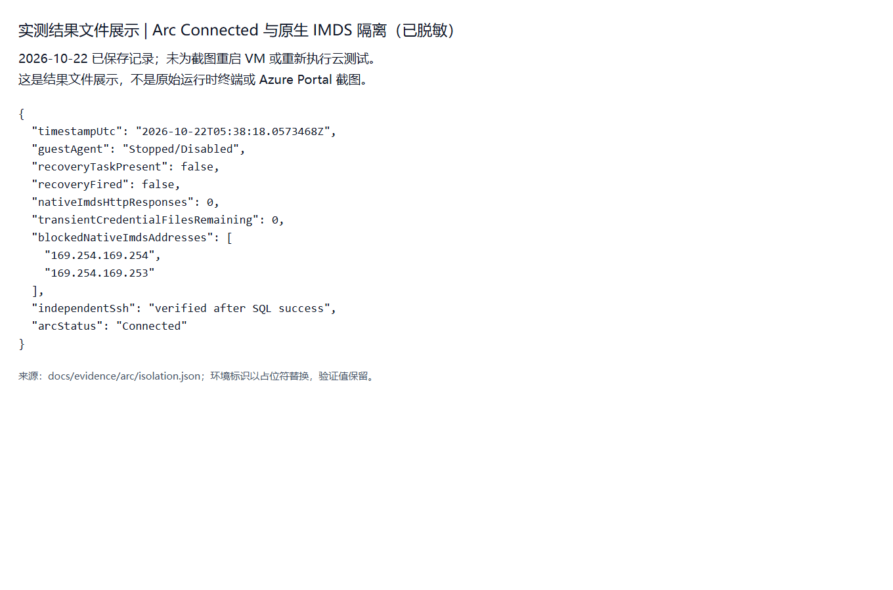

[对应脱敏 JSON](docs/evidence/arc/isolation.json)。图中时间为 UTC；它是查询后的隔离证明，**不是 VM 解除分配后仍保持 Connected 的承诺**。

## 3. Azure SQL 服务端配置

### 3.1 确认现有 Entra 管理员和数据库

打开 **SQL servers → 目标服务器 → Microsoft Entra ID**，确认已有管理员；打开 **SQL databases → 目标数据库 → Overview**，记录 `<SQL_SERVER_FQDN>` 和 `<DATABASE_NAME>`。

本次复用已有服务器、管理员和 `auth-test`，没有改 Entra 管理员、数据库配置或现有安全标签。管理员连接只用于核对既有 marker 和创建 Arc 最小用户，**不作为最终成功查询身份**。

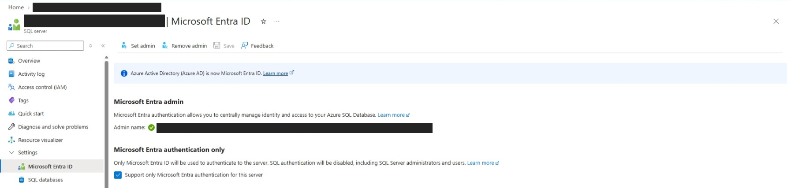

新环境若尚无 Entra 管理员，应由获批管理员通过 **Set admin → 选择用户／组 → Save** 配置；本次已有管理员，补图时未点击这些变更按钮。图中 **Support only Microsoft Entra authentication for this server** 是原服务器已启用的设置，**不是使用 Arc MI 必须新开的开关**，不要为了复现而关闭现有 SQL 密码登录。更不要把 Arc 机器身份设成服务器 Entra 管理员。

### 3.2 配置 SQL 网络

打开 **SQL server → Networking → Public access／Firewall rules**。仅当组织允许该公网方案时，给测试机**真实 SQL 出口 IPv4**增加单独规则，Start IP = End IP，不填工作站地址来代替机器出口。

本次只新增新 VM 静态公网 IP 的精确规则，未打开 `0.0.0.0` 的 Azure 服务例外、Internet 范围，也没有移除／放宽原规则或策略。

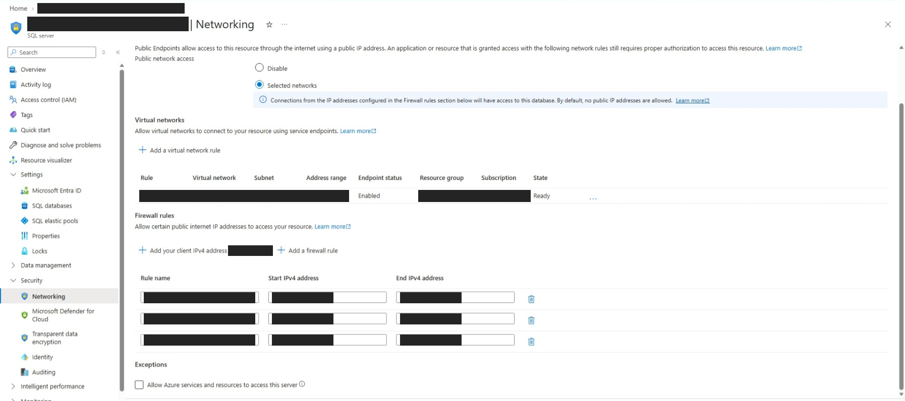

上图为本次服务器的真实配置页：**Selected networks** 已选，Firewall rules 第二行为本次新机规则；另外两行及上方 VNet 规则是原有配置，并非本次新增要求。实际只读核对了第二行 **Start IPv4 address = End IPv4 address = 新机出口地址**；公网 IP 与规则名已遮盖，因此截图用于说明 UI 位置，不能从黑块独立核验数值相等。下方 **Allow Azure services and resources to access this server** 未勾选。

获批配置新环境时，使用 **Add a firewall rule** 填入机器出口单 IP 后再保存；不要误用 **Add your client IPv4 address** 加入浏览器工作站 IP。本轮补图只读查看，未新增、编辑、删除或保存规则。

组织要求私网时，应由网络管理员提供 Private Endpoint、路由和 Private DNS；本次结果不构成私网验证。还需允许 Arc／Entra 必需出站及 SQL 1433／连接策略端口，不能用“SSH 能通”代替这些检查。

### 3.3 核对既有 marker

由 SQL 管理员连接**目标数据库，不是 master**，先执行：

```sql
IF OBJECT_ID(N'dbo.AuthProbe', N'U') IS NULL
    THROW 50001, 'Existing dbo.AuthProbe is missing.', 1;
SELECT id, marker FROM dbo.AuthProbe WHERE id = 1;
```

本次实际返回 `id=1`、`marker=passwordless-verified`；不匹配时停止，不创建新数据冒充原表。Serverless 数据库此前为 Paused，第一次连接出现 `40613` 后有限重试并成功恢复。

### 3.4 为 Arc 身份创建数据库用户，仅授予表级 SELECT

本次使用 Azure SQL 支持的显式 `SID + TYPE = E` 方式，将数据库用户映射到**已核对的 Arc 服务主体 Application／Client ID**。不是把 `principalId` 的字节误作本例服务主体 SID，也不是给接入管理员或新建公共客户端授权。

在管理工作站用已核对的 Client ID 计算 SID；结果不是秘密：

```powershell
$sid = '0x' + [BitConverter]::ToString(
    ([guid]'<ARC_CLIENT_ID>').ToByteArray()
).Replace('-', '')
$sid
```

由 SQL 管理员将结果替换下方 `<ARC_CLIENT_ID_HEX_SID>`，在目标数据库执行。`arc-sql-reader` 是可自定义的示例别名，后面的客户端校验需保持一致：

```sql
IF EXISTS (
    SELECT 1 FROM sys.database_principals
    WHERE name = N'arc-sql-reader'
      AND (sid <> <ARC_CLIENT_ID_HEX_SID> OR type <> 'E')
)
    THROW 50002, 'Existing SQL user has a different identity mapping.', 1;

IF NOT EXISTS (
    SELECT 1 FROM sys.database_principals WHERE name = N'arc-sql-reader'
)
    CREATE USER [arc-sql-reader] WITH SID = <ARC_CLIENT_ID_HEX_SID>, TYPE = E;

GRANT SELECT ON OBJECT::dbo.AuthProbe TO [arc-sql-reader];
```

执行者需具备数据库建用户和授权能力。显式 SID 方式要求管理员自行正确核对身份，不会替你完成目录名称解析；它不是绕过身份核验。本文截图将实测数据库别名统一脱敏为 `<ARC_SQL_USER>`。

**这一步是数据库内的 T-SQL 配置，不是 Azure Portal 的 Access control (IAM) 角色分配。** 可以由获批管理员使用 SSMS 等工具连接目标数据库；Portal **SQL databases → 目标数据库 → Query editor (preview)** 也只是执行 T-SQL 的入口，仍需独立的数据库登录及权限。本次没有为补图登录 Query editor 或重新执行授权。SQL server 菜单的 **Identity** 管理的是服务器自身身份，**不是 Arc 机器身份，也不需要仅为本文显式 SID 用户映射而额外开启**。

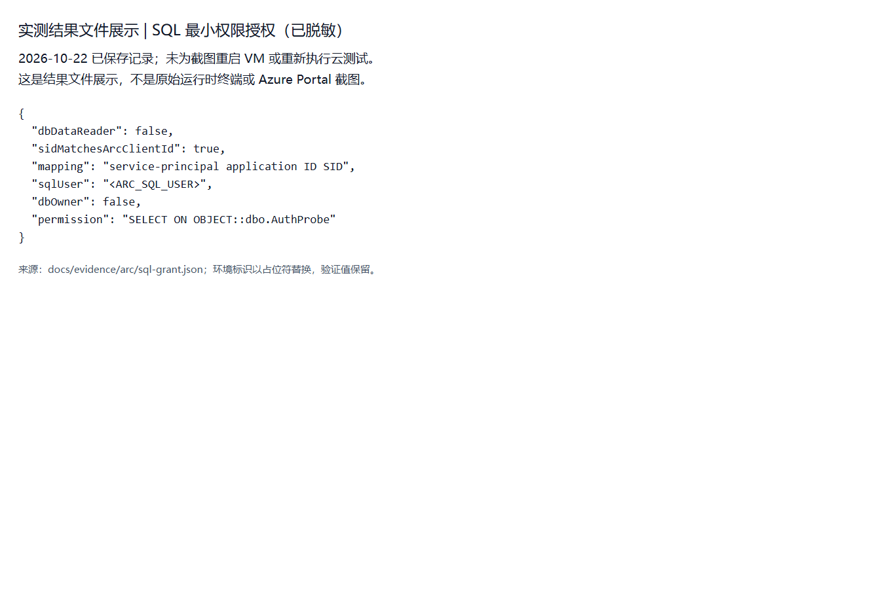

[对应脱敏 JSON](docs/evidence/arc/sql-grant.json)

## 4. 客户端连接示例

### 4.1 填入非秘密配置

在 Arc 机器的、具备本地 Token 读取权限的 PowerShell 会话中设置：

```powershell
$env:ARC_SQL_SERVER = '<SQL_SERVER_FQDN>'
$env:ARC_SQL_DATABASE = '<DATABASE_NAME>'
$env:ARC_SQL_TENANT_ID = '<SQL_AND_ARC_TENANT_ID>'
$env:ARC_SQL_PRINCIPAL_ID = '<ARC_PRINCIPAL_ID>'
$env:ARC_SQL_CLIENT_ID = '<ARC_CLIENT_ID>'
$env:ARC_SQL_USER = 'arc-sql-reader'
```

服务器名是 SQL FQDN，不加 `https://`。不设置 SQL 密码，不将管理员 Token 或接入 Token 传给此程序。最终 SQL 查询阶段不需要在这台机器上执行 `az login`。

### 4.2 请求 Arc SQL Token 并执行查询

下面是按实测机制整理的 Windows PowerShell 示例；截图来自本次已保存的实测结果，未为文档重新运行此示例。它显式选择 Arc 端点，**没有 `DefaultAzureCredential` 链或静默回退**。

<details>
<summary>展开：完整 Token challenge、身份检查和 SQL 查询示例</summary>

```powershell
$ErrorActionPreference = 'Stop'
$ProgressPreference = 'SilentlyContinue'
Add-Type -AssemblyName System.Data

foreach ($name in @('ARC_SQL_SERVER', 'ARC_SQL_DATABASE', 'ARC_SQL_TENANT_ID',
                    'ARC_SQL_PRINCIPAL_ID', 'ARC_SQL_CLIENT_ID', 'ARC_SQL_USER')) {
    if ([string]::IsNullOrWhiteSpace([Environment]::GetEnvironmentVariable($name))) {
        throw "Missing configuration: $name"
    }
}

$endpoint = 'http://localhost:40342/metadata/identity/oauth2/token' +
    '?api-version=2020-06-01&resource=https%3A%2F%2Fdatabase.windows.net%2F'
$connection = $null
$token = $null
$challenge = $null
try {
    $challengePath = $null
    try {
        Invoke-WebRequest -Uri $endpoint -Headers @{Metadata='true'} `
            -UseBasicParsing -TimeoutSec 30 -Proxy $null | Out-Null
        throw 'Expected an Arc challenge, not an unauthenticated success.'
    } catch {
        $response = $_.Exception.Response
        if (-not $response -or [int]$response.StatusCode -ne 401) { throw }
        $header = $response.Headers['WWW-Authenticate']
        if ($header -notmatch '^Basic realm=(.+)$') { throw 'Unexpected challenge.' }
        $challengePath = [IO.Path]::GetFullPath($Matches[1].Trim('"'))
        $root = Join-Path $env:ProgramData 'AzureConnectedMachineAgent\Tokens\'
        if (-not $challengePath.StartsWith($root, [StringComparison]::OrdinalIgnoreCase)) {
            throw 'Challenge path is outside the documented Arc token directory.'
        }
    }
    $challenge = (Get-Content -LiteralPath $challengePath -Raw).Trim()
    $reply = Invoke-RestMethod -Uri $endpoint `
        -Headers @{Metadata='true'; Authorization="Basic $challenge"} `
        -TimeoutSec 30 -Proxy $null
    $challenge = $null
    $token = $reply.access_token
    $reply = $null
    if (-not $token) { throw 'Arc did not return a token.' }

    $part = $token.Split('.')[1].Replace('-', '+').Replace('_', '/')
    $part = $part.PadRight($part.Length + ((4 - $part.Length % 4) % 4), '=')
    $claims = [Text.Encoding]::UTF8.GetString(
        [Convert]::FromBase64String($part)) | ConvertFrom-Json
    $clientId = if ($claims.appid) { $claims.appid } else { $claims.azp }
    if ($claims.aud.TrimEnd('/') -ne 'https://database.windows.net' -or
        $claims.tid -ne $env:ARC_SQL_TENANT_ID -or
        $claims.oid -ne $env:ARC_SQL_PRINCIPAL_ID -or
        $clientId -ne $env:ARC_SQL_CLIENT_ID) {
        throw 'Token does not match the expected SQL audience and Arc identity.'
    }

    $builder = New-Object System.Data.SqlClient.SqlConnectionStringBuilder
    $builder.DataSource = "tcp:$($env:ARC_SQL_SERVER),1433"
    $builder.InitialCatalog = $env:ARC_SQL_DATABASE
    $builder.Encrypt = $true
    $builder.TrustServerCertificate = $false
    $builder.ConnectTimeout = 45
    $builder.Pooling = $false
    $connection = New-Object System.Data.SqlClient.SqlConnection
    $connection.ConnectionString = $builder.ConnectionString
    $connection.AccessToken = $token
    $token = $null

    for ($attempt = 1; $attempt -le 6; $attempt++) {
        try { $connection.Open(); break }
        catch [System.Data.SqlClient.SqlException] {
            if ($_.Exception.Number -notin @(40613,40197,40501,10928,10929,49918,49919,49920) -or
                $attempt -eq 6) { throw }
            Write-Warning "Transient SQL error $($_.Exception.Number), attempt $attempt/6."
            Start-Sleep -Seconds 20
        }
    }

    function Read-Query([string]$sql) {
        $command = $connection.CreateCommand()
        $command.CommandText = $sql
        $command.CommandTimeout = 60
        $reader = $null
        try {
            $reader = $command.ExecuteReader()
            $rows = @()
            while ($reader.Read()) {
                $row = [ordered]@{}
                for ($i = 0; $i -lt $reader.FieldCount; $i++) {
                    $row[$reader.GetName($i)] = $reader.GetValue($i)
                }
                $rows += [pscustomobject]$row
            }
            return $rows
        } finally {
            if ($reader) { $reader.Dispose() }
            $command.Dispose()
        }
    }

    $identity = @(Read-Query 'SELECT ORIGINAL_LOGIN() AS originalLogin,
        USER_NAME() AS userName, DB_NAME() AS databaseName;')[0]
    if ($identity.userName -ne $env:ARC_SQL_USER -or
        $identity.databaseName -ne $env:ARC_SQL_DATABASE) {
        throw 'SQL resolved an unexpected database user.'
    }
    $marker = @(Read-Query 'SELECT id, marker FROM dbo.AuthProbe WHERE id=1;')
    if ($marker.Count -ne 1 -or $marker[0].marker -ne 'passwordless-verified') {
        throw 'Unexpected marker result.'
    }
    $permissions = @(Read-Query "SELECT
        HAS_PERMS_BY_NAME(N'dbo.AuthProbe', N'OBJECT', N'SELECT') AS canSelect,
        HAS_PERMS_BY_NAME(N'dbo.AuthProbe', N'OBJECT', N'INSERT') AS canInsert,
        HAS_PERMS_BY_NAME(N'dbo.AuthProbe', N'OBJECT', N'UPDATE') AS canUpdate,
        HAS_PERMS_BY_NAME(N'dbo.AuthProbe', N'OBJECT', N'DELETE') AS canDelete,
        IS_ROLEMEMBER(N'db_owner') AS dbOwner,
        IS_ROLEMEMBER(N'db_datareader') AS dbDataReader;")[0]
    if ($permissions.canSelect -ne 1 -or $permissions.canInsert -ne 0 -or
        $permissions.canUpdate -ne 0 -or $permissions.canDelete -ne 0 -or
        $permissions.dbOwner -ne 0 -or $permissions.dbDataReader -ne 0) {
        throw 'Effective permissions exceed or do not match the approved SELECT.'
    }
    @{
        result='ARC_SQL_QUERY_SUCCEEDED'
        identity=$identity
        marker=$marker[0].marker
        permissions=$permissions
        authentication='explicit Arc endpoint token only; SqlConnection.AccessToken'
        fallback='none'
    } | ConvertTo-Json -Depth 4
} finally {
    if ($connection) { $connection.Dispose() }
    $token = $null
    $challenge = $null
}
```

示例只输出身份与查询结果，不输出 Token、challenge 或 Agent 证书。输出中的真实身份标识仍应在对外分享前脱敏。

</details>

## 5. 实测结果

**2026-10-22，新订阅 Compute → 原租户 Arc 系统身份 → 原 SQL 查询成功：**

| 验证项 | 实际结果 |
| --- | --- |
| Arc 状态 | 查询前后均验证 `Connected`；ARM 资源为独立 `Microsoft.HybridCompute/machines` |
| 本机端点 | `http://localhost:40342/metadata/identity/oauth2/token` |
| Token audience | `https://database.windows.net` |
| Token 身份 | `tid` 与 SQL／Arc 租户一致；`oid` 匹配 Arc principalId；`appid` 匹配该服务主体 appId |
| SQL 当前身份 | `ORIGINAL_LOGIN()` 对应 `<ARC_CLIENT_ID>@<TENANT_ID>`；`USER_NAME()` 为最小权限 Arc 数据库用户，不是 dbo |
| 数据库与表 | 目标数据库 `auth-test`；既有 `dbo.AuthProbe`，返回 1 行 |
| 查询值 | `passwordless-verified` |
| 有效权限 | SELECT=1；INSERT／UPDATE／DELETE=0；db_owner／db_datareader=0 |
| 其他认证 | 无用户 WAM、CLI、交互登录或原生 VM MI 回退 |
| 隔离与凭据清理 | Guest Agent Stopped／Disabled；两个原生 IMDS 均无 HTTP 响应；恢复未触发、任务已撤销；临时凭据文件剩余 0 |

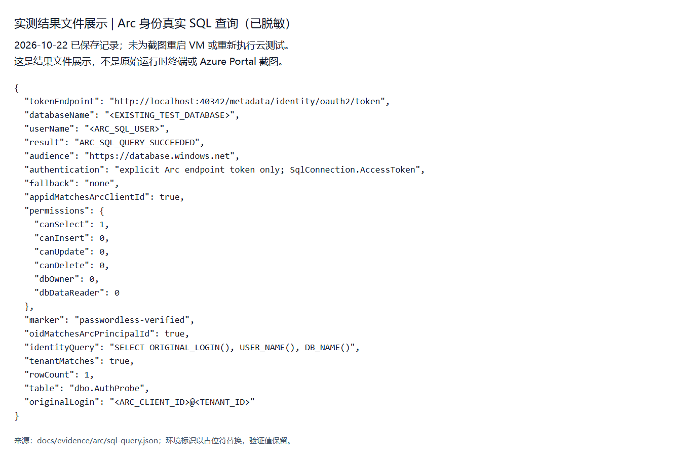

[对应脱敏 JSON](docs/evidence/arc/sql-query.json)

**截图说明：** 本文包含两类图片：第 2／3 节新增的五张 `portal-arc-*.png` 是**真实 Azure Portal UI 截图**，仅裁剪与实色遮盖环境标识，保留实际配置和停机后的 Offline／Disconnected 状态；原五张 `arc-*.png` 则是**已保存实测结果文件的脱敏页面截图，不是原始运行时终端或 Portal 图**，可与对应 JSON 对照。未为补图重启 VM、重跑测试或改云配置，也未借用旧 WAM 图冒充本次结果。公开图片和证据不包含真实订阅／租户／机器／公网 IP／主体标识。

## 6. 结束状态、保留变更与费用边界

本次按批准约定，在成功后、北京时间 **14:49 硬截止前**，将**新测试 VM 解除分配**，并再次从 Azure 核对 `PowerState/deallocated`。**解除分配不是删除；本次没有删除任何 Azure 资源。**

| 保留项 | 最终状态／注意事项 |
| --- | --- |
| 新 Compute VM 与依赖 | VM、OS 磁盘、VNet、NSG、NIC、静态公网 IP，共 6 项资源保留；VM 已 Deallocated |
| Arc 机器资源 | 保留机器及系统身份；结果文件中的 Connected 是停机前实测状态，后补 Portal 截图为停机后的 Offline／Disconnected |
| SQL 授权 | 保留 Arc 数据库用户及仅 `dbo.AuthProbe` SELECT；未授予写权限或数据库角色 |
| SQL 防火墙 | 保留精确到新机出口单 IPv4 的规则；原规则与策略未变 |
| 管理网络 | 本次单独批准的仅 TCP443 Any 来源例外保留；不应无审批照搬到客户环境 |
| 临时接入材料 | 本次创建的临时凭据输入／配置文件已删除；不删除 Agent 自己管理的身份材料 |
| 原有环境 | 旧 WAM VM、旧评估 VM 未修改；结束时只读核对二者均为 Deallocated |
| SQL 电源状态 | 查询唤醒后为 Online；原 Serverless 自动暂停 60 分钟配置不变，不等于查询一结束立即 Paused |

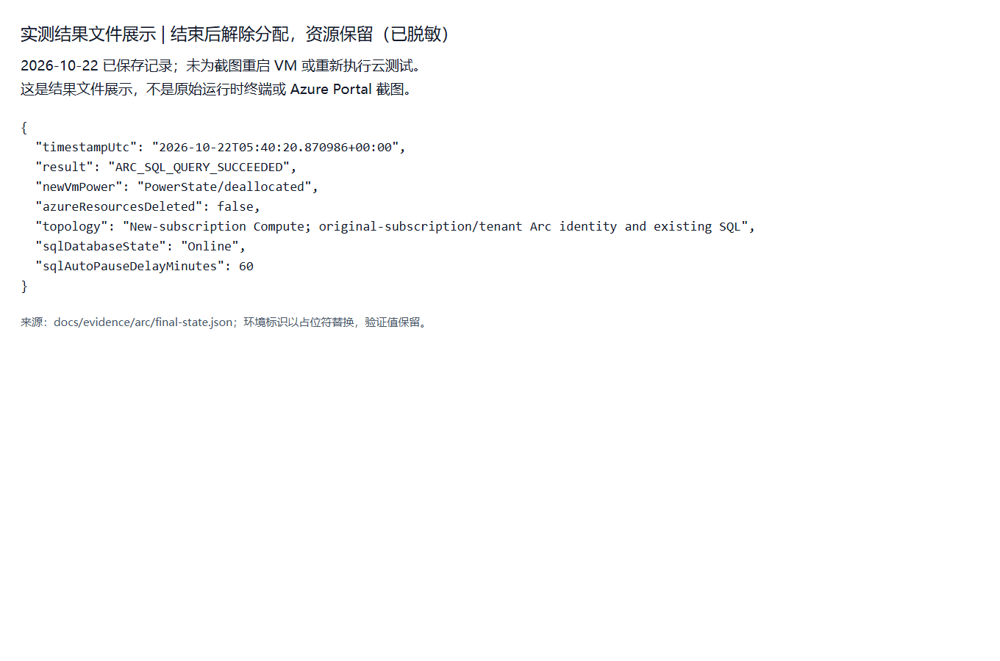

[对应脱敏 JSON](docs/evidence/arc/final-state.json)

**计费不等于全部停止：** 新 VM 解除分配停止其计算计费，但保留磁盘／静态 IP 继续计费；此前批准方案的估算约 **US$13.25／月**，这是当时估算，不是实时账单。本次接受了原订阅可能继承的 Defender for Servers P2 单机费用，未更改安全设置或添加豁免；**保留 Arc／Defender 资源可能继续计费**。SQL 恢复后的计算、存储及流量等另计，不能把 VM 停机当作 SQL 或 Defender 已停止收费。

后续若要重测、收紧临时网络或清理资源，应另行确认范围；本文不自动执行这些动作。删除并重新创建 Arc 系统身份可能产生新的身份标识，不能假设旧 SQL SID 授权仍然匹配。

## 7. 复核资料与常见问题

| 问题 | 应核查的边界 |
| --- | --- |
| SSH 不通 | 来源 IP／NAT、NSG、来宾防火墙、sshd 监听及主机公钥；先解决管理通道，不在 Guest Agent 停用后赌 RunCommand 可用 |
| 无法读取 challenge | 当前进程的本地组权限与返回路径；不要改为读取用户私有凭据，也不要为此广泛放宽 Arc Tokens 目录 ACL |
| Token 身份不匹配 | Arc 资源 tenant／principalId、Graph appId、Token aud／tid／oid／appid；不要使用 Compute 租户标识代替 Arc 身份 |
| SQL 首连 `40613` | 本次为已暂停的 Serverless 唤醒过程；只对明确瞬态错误做有限重试，不能吞掉其他异常 |
| SQL 身份登录失败 | 检查目标数据库、SQL 网络、SQL Entra 管理员及数据库 SID 映射；Arc Connected 不等于已有 SQL 权限 |
| 想换用 Azure VM 原生 MI | 那是另一条身份路径；不要在本评估隔离仍有效时混用，也不能把其成功算作 Arc Token 成功 |

公共结果文件均在 [docs/evidence/arc](docs/evidence/arc)，只保留核查所需字段；原始含环境标识的记录和 Portal 原图不纳入仓库。图像生成器 [docs/render_arc_evidence.py](docs/render_arc_evidence.py) 只读取这些脱敏 JSON，在本地浏览器截图，**没有 Azure 登录或云操作，也不能生成真实 Portal UI 图**。第 2／3 节的 Portal 图来自已登录浏览器的真实页面采集。复生成五张结果文件图需已有 Python Playwright 和 Chromium；也可通过 `--browser` 指定已安装的 Chromium／Edge：

```powershell
python .\docs\render_arc_evidence.py
```

## 参考

[Azure VM 仅供评估的 Arc 配置](https://learn.microsoft.com/en-us/azure/azure-arc/servers/plan-evaluate-on-azure-virtual-machine) · [Arc 托管身份与本机 challenge](https://learn.microsoft.com/en-us/azure/azure-arc/servers/managed-identity-authentication) · [azcmagent connect 与配置文件](https://learn.microsoft.com/en-us/azure/azure-arc/servers/azcmagent-connect) · [CREATE USER／SID／TYPE](https://learn.microsoft.com/en-us/sql/t-sql/statements/create-user-transact-sql?view=azuresqldb-current) · [Azure SQL Entra 配置](https://learn.microsoft.com/en-us/azure/azure-sql/database/authentication-aad-configure?view=azuresql) · [SQL 网络连接架构](https://learn.microsoft.com/en-us/azure/azure-sql/database/connectivity-architecture?view=azuresql)
