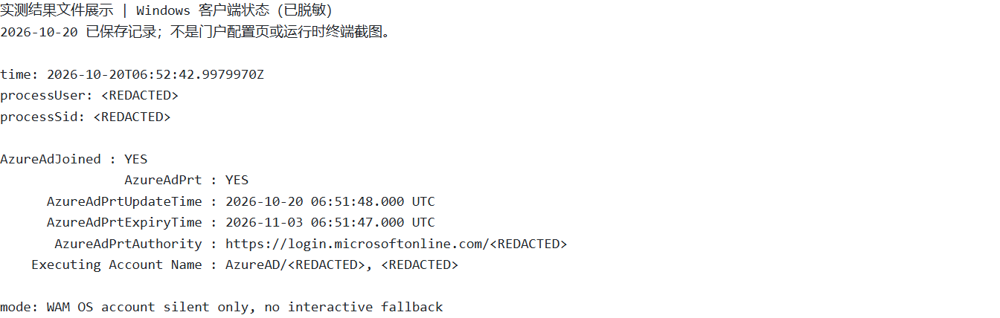
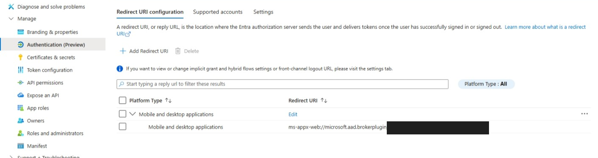
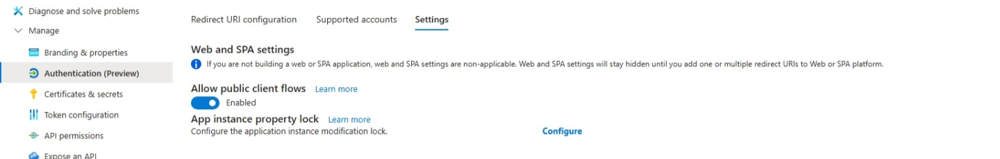
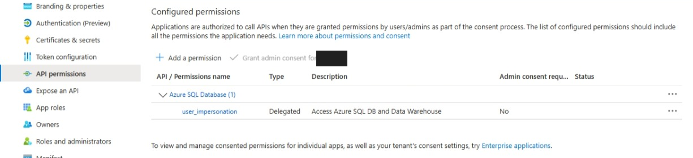
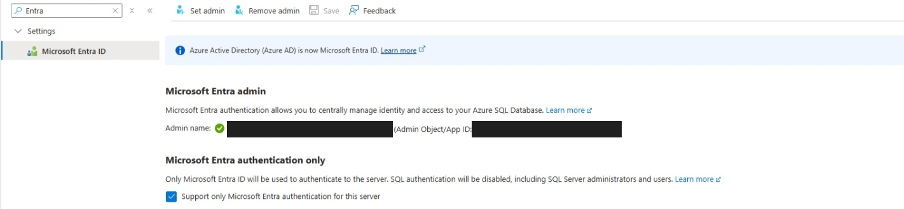
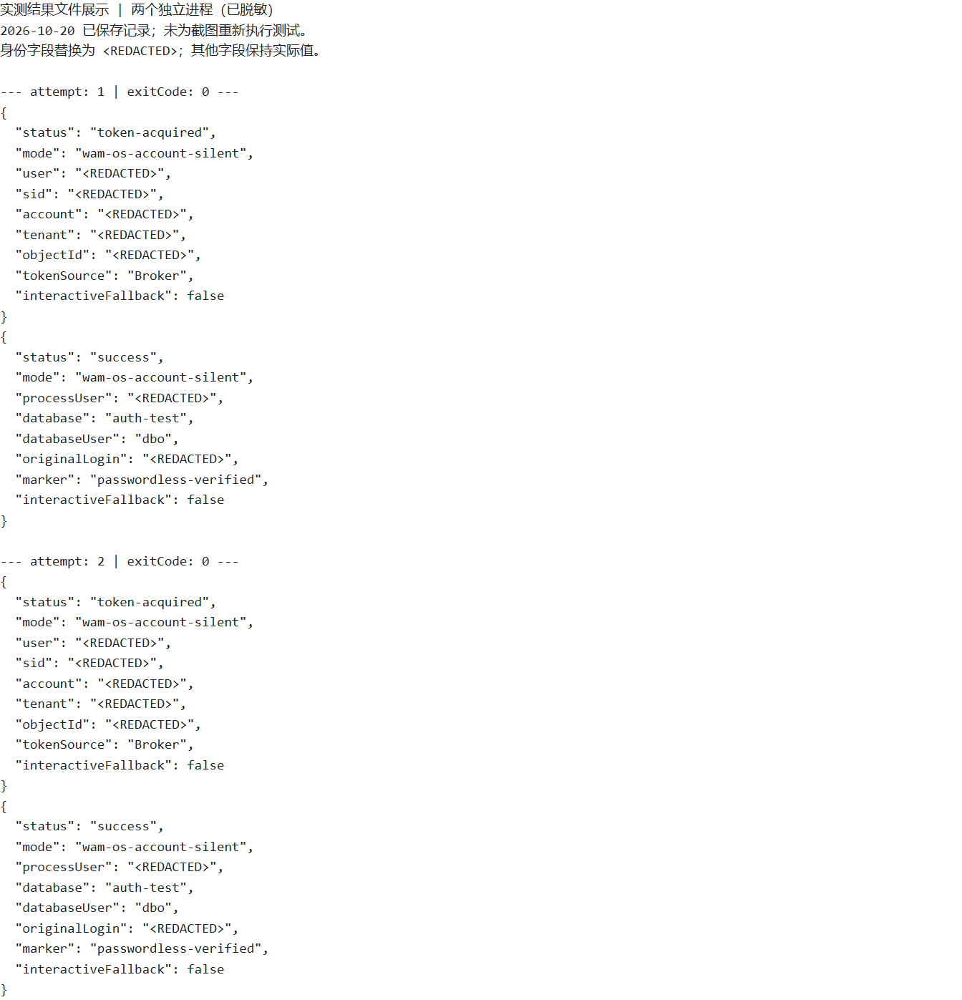

# 客户示例：使用 Windows WAM 静默访问 Azure SQL

**场景：** 用户已经使用 Microsoft Entra 账户登录 Windows，应用通过 WAM 获取当前用户的令牌，再连接 Azure SQL。查询时不需要 SQL 密码、`az login`、浏览器弹窗或再次交互式 MFA。普通本地 Windows 电脑即可，**不要求 Azure VM，也不使用托管身份**。

```text
Windows 当前用户 → WAM / 已有登录状态（PRT）→ 用户访问令牌 → Azure SQL
```

以下是已验证的具体配置示例。首次 Windows 登录、应用同意和数据库授权需要预先完成；如果组织策略要求重新登录或 MFA，本示例明确失败，不自动弹窗。

## 1. 客户端配置

### Windows 电脑

| 配置项 | 本例配置 |
| --- | --- |
| 系统 | Windows 11 Pro 25H2 |
| 设备与账户 | 设备加入目标 Entra 租户，用户使用该租户的 Entra 账户登录 Windows |
| 登录状态 | 在该用户桌面运行 `dsregcmd /status`，确认 `AzureAdJoined : YES`、`AzureAdPrt : YES` |
| 执行位置 | 当前用户的交互式桌面控制台；不使用 SYSTEM、Windows 服务或其他用户身份 |
| 开发环境 | .NET SDK 8.0.426，目标框架 `net8.0-windows` |
| 客户端包 | `Microsoft.Data.SqlClient` 6.1.4、`Microsoft.Identity.Client.Broker` 4.77.0 |

设备加入由客户 IT 按组织流程完成，可在 Windows **设置 → 账户 → 访问工作或学校**中核对。PRT 为 YES 之后，仍需完成下述应用和 SQL 授权。



### Entra 应用：管理员一次性配置

在 **Azure Portal → Microsoft Entra ID → 应用注册 → 新注册**创建专用应用，然后填写：

| 位置／配置项 | 具体设置 |
| --- | --- |
| 支持的账户类型 | 仅此组织目录中的账户（单租户） |
| 概述 | 记录 Directory (tenant) ID 和 Application (client) ID，分别作为 `<TENANT_ID>`、`<CLIENT_ID>` |
| 身份验证 → 添加平台 | **移动和桌面应用程序** |
| Redirect URI | `ms-appx-web://microsoft.aad.brokerplugin/<CLIENT_ID>` |
| 身份验证 → Settings → Allow public client flows | **Enabled（是）**，对应 `isFallbackPublicClient=true`；旧版页面名称为“允许公共客户端流” |
| API 权限 → 添加权限 | **我的组织使用的 API → Azure SQL Database → 委托的权限 → user_impersonation** |
| 密码／证书 | **不创建**；这是公共客户端 |

若门户搜索名称不同，可按 Azure SQL 资源应用 ID `022907d3-0f1b-48f7-badc-1ba6abab6d66` 查找；`user_impersonation` 的权限 ID 为 `c39ef2d1-04ce-46dc-8b5f-e9a5c60f0fc9`。

以下配置图均通过 GitHub Copilot Computer Use 从实际 Azure Portal 页面截取，仅裁剪并遮盖敏感信息，未修改配置值。

**回调 URI：** 身份验证 → Redirect URI configuration，平台为 Mobile and desktop applications；黑色遮盖处为本应用的 Client ID，完整格式见上表。



**公共客户端：** 同一页面的 Settings 中，Allow public client flows 为 Enabled。



**SQL API 权限：** API permissions 中为 Azure SQL Database 的 `user_impersonation`，类型为 Delegated。该图只展示应用声明的权限，Status 空白不能用于判断某个用户是否已完成同意。



**本例只给一个用户预先同意，不给全租户授权。** 由获授权的目录管理员通过 Microsoft Graph 创建以下授权；不要点击面向整个组织的“授予管理员同意”来替代：

```http
POST https://graph.microsoft.com/v1.0/oauth2PermissionGrants
Content-Type: application/json

{
  "clientId": "<CLIENT_SERVICE_PRINCIPAL_OBJECT_ID>",
  "consentType": "Principal",
  "principalId": "<USER_OBJECT_ID>",
  "resourceId": "<AZURE_SQL_RESOURCE_SERVICE_PRINCIPAL_OBJECT_ID>",
  "scope": "user_impersonation"
}
```

这里的 `clientId` 是**企业应用的对象 ID**，不是上表的 Application (client) ID；`resourceId` 是 Azure SQL 服务主体在**客户自己租户**中的对象 ID。可在 **企业应用**中查找对应应用，或通过 `GET /v1.0/servicePrincipals?$filter=appId eq '<APPLICATION_CLIENT_ID>'` 查询；查 SQL 资源时使用上面的固定资源应用 ID。`principalId` 是目标用户的对象 ID。

执行该 Graph 写操作的管理工具需 `DelegatedPermissionGrant.ReadWrite.All`，执行者还需符合 API 要求的 Entra 角色与租户策略，例如 Application Administrator／Cloud Application Administrator。读取服务主体需适当目录读取权限。这些是**管理工具权限，不加到 SQL 客户端应用**；普通用户不需管理员权限。已有授权时由管理员核对后更新，勿重复创建。应用同意**不等于 SQL 数据库权限**。

## 2. Azure SQL 服务端配置

| 位置 | 客户需要配置什么 |
| --- | --- |
| Azure 门户 → SQL 服务器 → Microsoft Entra ID | 设置本租户的 Entra 管理员，用于首次创建数据库用户；**普通使用者不设为管理员** |
| SQL 数据库 | 本例为 `auth-test`；客户端必须显式指定目标数据库 |
| SQL 服务器 → 网络 | 优先使用 Private Endpoint，并保证客户端 VPN／路由及 Private DNS 正常；若组织允许公共访问，仅允许真实客户端 SQL 出口 IP |
| 客户端连接 | 使用 `<SQL_SERVER_FQDN>,1433`；保留 `Encrypt=true`、`TrustServerCertificate=false` |
| 数据库授权 | 为目标 Entra 用户／组创建 contained user，只授予查询所需权限 |

**SQL 服务器 → Microsoft Entra ID：** 实际页面显示已配置 Entra 管理员，账户及对象 ID 已遮盖。图中还启用了“仅 Microsoft Entra 身份验证”；这是实验服务器的设置，**不是 WAM 的必要条件**，客户应按自身认证策略决定是否禁用 SQL 密码认证。



网络需符合客户策略；不要用策略例外标签或放宽整个 Internet 地址范围解决连接问题。Azure SQL Redirect 连接策略可能还需要额外数据端口，按实际网络架构配置。

SQL 管理员连接 **`auth-test` 数据库，而不是 `master`**，执行以下首次演示脚本。替换虚构 UPN；同名对象已存在时先核对，不要直接覆盖。

```sql
CREATE TABLE dbo.WamSsoDemo
(
    Id int NOT NULL PRIMARY KEY,
    Marker nvarchar(100) NOT NULL
);
INSERT INTO dbo.WamSsoDemo VALUES (1, N'passwordless-verified');

CREATE USER [reader@contoso.example] FROM EXTERNAL PROVIDER;
GRANT SELECT ON OBJECT::dbo.WamSsoDemo TO [reader@contoso.example];
```

生产环境可对 Entra 安全组创建数据库用户并授权，便于统一管理成员。创建外部用户需管理员具备适当 SQL 权限及目录主体解析权限，具体取决于执行身份与租户配置。

## 3. 客户端连接示例

客户端只需要四项配置：**Tenant ID、Client ID、SQL 服务器 FQDN、数据库名**，没有密码。

```powershell
$env:WAM_SQL_TENANT_ID = '<TENANT_ID>'
$env:WAM_SQL_CLIENT_ID = '<CLIENT_ID>'
$env:WAM_SQL_SERVER = '<SQL_SERVER_FQDN>' # 例如 your-server.database.windows.net
$env:WAM_SQL_DATABASE = 'auth-test'
```

<details>
<summary>展开：完整 .NET 示例与运行命令</summary>

创建控制台项目：

```powershell
dotnet new console --framework net8.0 --name WamSqlProbe
Set-Location .\WamSqlProbe
```

将 `WamSqlProbe.csproj` 替换为：

```xml
<Project Sdk="Microsoft.NET.Sdk">
  <PropertyGroup>
    <OutputType>Exe</OutputType>
    <TargetFramework>net8.0-windows</TargetFramework>
    <ImplicitUsings>enable</ImplicitUsings>
    <Nullable>enable</Nullable>
  </PropertyGroup>
  <ItemGroup>
    <PackageReference Include="Microsoft.Data.SqlClient" Version="6.1.4" />
    <PackageReference Include="Microsoft.Identity.Client.Broker" Version="4.77.0" />
  </ItemGroup>
</Project>
```

将 `Program.cs` 替换为：

```csharp
using Microsoft.Data.SqlClient;
using Microsoft.Identity.Client;
using Microsoft.Identity.Client.Broker;
using System.Runtime.InteropServices;

try
{
    string tenant = Config("WAM_SQL_TENANT_ID");
    string client = Config("WAM_SQL_CLIENT_ID");
    string server = Config("WAM_SQL_SERVER");
    string database = Config("WAM_SQL_DATABASE");
    if (!Guid.TryParse(tenant, out _) || !Guid.TryParse(client, out _))
        throw new ArgumentException("Tenant ID and client ID must be GUIDs.");

    using var timeout = new CancellationTokenSource(TimeSpan.FromMinutes(3));
    var ct = timeout.Token;
    var app = PublicClientApplicationBuilder.Create(client)
        .WithAuthority($"https://login.microsoftonline.com/{tenant}")
        .WithDefaultRedirectUri()
        .WithParentActivityOrWindow(() => NativeMethods.GetConsoleWindow())
        .WithBroker(new BrokerOptions(BrokerOptions.OperatingSystems.Windows))
        .Build();
    var auth = await app.AcquireTokenSilent(
        new[] { "https://database.windows.net//.default" },
        PublicClientApplication.OperatingSystemAccount).ExecuteAsync(ct);

    Console.WriteLine($"TokenSource={auth.AuthenticationResultMetadata.TokenSource}");
    Console.WriteLine("interactiveFallback=false");
    Console.WriteLine($"Account={auth.Account.Username}");
    if (auth.AuthenticationResultMetadata.TokenSource.ToString() != "Broker" ||
        !string.Equals(auth.TenantId, tenant, StringComparison.OrdinalIgnoreCase))
        throw new InvalidOperationException("Unexpected token source or tenant.");

    var csb = new SqlConnectionStringBuilder
    {
        DataSource = $"tcp:{server},1433", InitialCatalog = database,
        Encrypt = true, TrustServerCertificate = false,
        ConnectTimeout = 60, Pooling = false,
        ApplicationName = "WamSqlProbe-silent-only"
    };
    await using var connection = new SqlConnection(csb.ConnectionString);
    connection.AccessToken = auth.AccessToken;
    await connection.OpenAsync(ct);
    await using var command = connection.CreateCommand();
    command.CommandTimeout = 60;
    command.CommandText = """
        SELECT ORIGINAL_LOGIN() AS OriginalLogin, USER_NAME() AS DatabaseUser,
               DB_NAME() AS DatabaseName, Marker
        FROM dbo.WamSsoDemo WHERE Id = 1;
        """;
    await using var reader = await command.ExecuteReaderAsync(ct);
    if (!await reader.ReadAsync(ct))
        throw new InvalidOperationException("Demo result was empty.");
    for (int i = 0; i < reader.FieldCount; i++)
        Console.WriteLine($"{reader.GetName(i)}={reader.GetString(i)}");
    if (!string.Equals(reader.GetString(2), database, StringComparison.OrdinalIgnoreCase) ||
        reader.GetString(3) != "passwordless-verified")
        throw new InvalidOperationException("Unexpected database or marker.");
    return 0;
}
catch (MsalUiRequiredException ex)
{
    Console.Error.WriteLine($"Silent authentication failed: {ex.ErrorCode}. " +
        "Check Windows sign-in, consent and policy; no interactive fallback.");
    return 10;
}
catch (MsalException ex)
{
    Console.Error.WriteLine($"MSAL failed: {ex.ErrorCode}");
    return 11;
}
catch (SqlException ex)
{
    Console.Error.WriteLine($"SQL failed: Number={ex.Number}");
    return 12;
}
catch (OperationCanceledException)
{
    Console.Error.WriteLine("Operation timed out.");
    return 13;
}
catch (ArgumentException ex)
{
    Console.Error.WriteLine($"Invalid configuration: {ex.Message}");
    return 14;
}

static string Config(string name) =>
    Environment.GetEnvironmentVariable(name) is { Length: > 0 } value
        ? value.Trim() : throw new ArgumentException($"Set {name}.");

internal static class NativeMethods
{
    [DllImport("kernel32.dll")]
    internal static extern IntPtr GetConsoleWindow();
}
```

在已登录的 Windows 用户桌面运行；每次 `dotnet` 调用都是新进程：

```powershell
dotnet build --configuration Release
if ($LASTEXITCODE -ne 0) { throw '构建失败' }
dotnet .\bin\Release\net8.0-windows\WamSqlProbe.dll
if ($LASTEXITCODE -ne 0) { throw '第一次验证失败' }
dotnet .\bin\Release\net8.0-windows\WamSqlProbe.dll
if ($LASTEXITCODE -ne 0) { throw '第二次验证失败' }
```

保留实测 scope `https://database.windows.net//.default`：SQL 资源结尾 `/` 与 `/.default` 拼接形成双斜杠。不要打印访问令牌；长期运行的应用另需处理令牌过期与连接生命周期。不同窗口宿主需按 WAM 指南提供有效 HWND。

</details>

## 4. 实测结果

**2026-10-20，两个独立新进程均成功：**

| 验证项 | 结果 |
| --- | --- |
| Windows 状态 | `AzureAdJoined=YES`、`AzureAdPrt=YES` |
| 令牌来源 | 两次均为 `Broker` |
| 交互回退 | 两次均为 `false`，没有调用交互式认证 |
| SQL 连接 | 两次退出码均为 `0`，数据库为 `auth-test` |
| SQL 当前身份 | `ORIGINAL_LOGIN()` 为实际 Windows 登录的 Entra 用户，不是托管身份 |
| 查询结果 | 两次均读到 `passwordless-verified` |



**结果图说明：** 本节结果图与第 1 节 Windows 状态图是既有实测结果文件的脱敏展示截图，不是原始运行时终端截图；与上面的真实 Azure Portal 配置截图来源不同，未为制作截图重新执行云测试。身份字段替换为 `<REDACTED>`，状态与查询结果保持原值。原测试账户已是服务器 Entra 管理员，所以文件中 `databaseUser` 为 `dbo`；客户应使用第 2 节的最小权限用户／组，不需要管理员身份。

本例未使用 CLI／托管身份凭据或自定义持久化令牌缓存；WAM 本身会维护 Windows 登录与令牌状态。已有 SQL 工具必须支持 WAM 或安全的令牌注入，不能仅凭 `sqlcmd -G` 推断可用。

## 参考

[WAM 配置与窗口要求](https://learn.microsoft.com/en-us/entra/msal/dotnet/acquiring-tokens/desktop-mobile/wam) · [单用户委托授权 API](https://learn.microsoft.com/en-us/graph/api/oauth2permissiongrant-post?view=graph-rest-1.0) · [Azure SQL Entra 配置](https://learn.microsoft.com/en-us/azure/azure-sql/database/authentication-aad-configure?view=azuresql) · [SQL 网络连接架构](https://learn.microsoft.com/en-us/azure/azure-sql/database/connectivity-architecture?view=azuresql)
