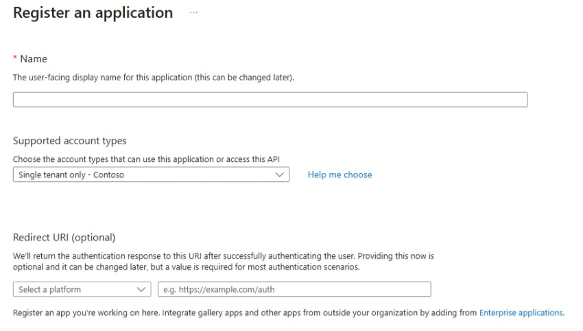
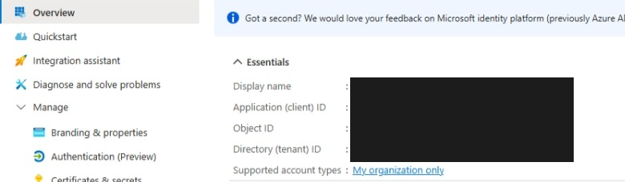
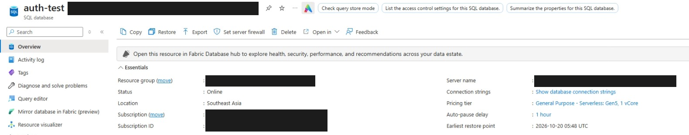
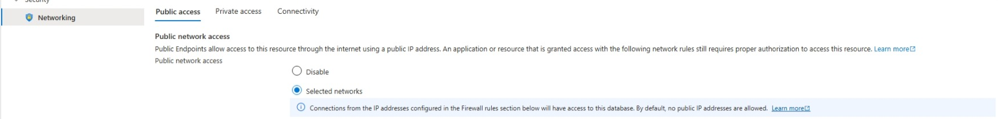
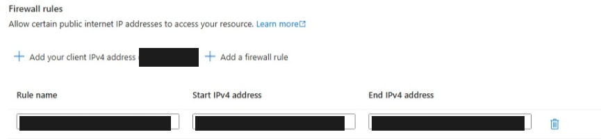

# 客户示例：使用 Windows WAM 静默访问 Azure SQL

用户已使用 Microsoft Entra 账户登录 Windows，客户端通过 WAM 获取当前用户令牌并连接 Azure SQL，查询时不输入 SQL 密码、不执行 `az login`、不弹出登录窗口。**不要求 Azure VM，不使用托管身份。**

按以下顺序完成配置。首次 Windows 登录、应用同意和数据库授权需预先完成；策略要求重新登录或 MFA 时，本示例失败退出，不自动弹窗。Portal 配置图由 GitHub Copilot Computer Use 从真实页面截取，仅裁剪并遮盖敏感信息。

## 1. 客户端配置

### 1.1 确认 Windows 登录状态

| 配置项 | 本例配置 |
| --- | --- |
| 系统 | Windows 11 Pro 25H2 |
| 设备与账户 | 设备加入目标 Entra 租户，用户使用该租户的 Entra 账户登录 Windows |
| 登录状态 | 在该用户桌面运行 `dsregcmd /status`，确认 `AzureAdJoined : YES`、`AzureAdPrt : YES` |
| 执行位置 | 当前用户的交互式桌面控制台；不使用 SYSTEM、Windows 服务或其他用户身份 |
| 开发环境 | .NET SDK 8.0.426，目标框架 `net8.0-windows` |
| 客户端包 | `Microsoft.Data.SqlClient` 6.1.4、`Microsoft.Identity.Client.Broker` 4.77.0 |


### 1.2 注册单租户应用

管理员打开 **Azure Portal → Microsoft Entra ID → App registrations（应用注册）→ New registration**：

1. Name 填写客户自己的应用名，例如 `WamSqlClient`。
2. Supported account types 选择 **Single tenant only（仅本组织）**。
3. Redirect URI 暂留空，点击 **Register**；下一步取得 Client ID 后再配置。

下图为注册表单入口展示，未为截图新建应用。



### 1.3 记录 Tenant ID 和 Client ID

打开该应用的 **Overview（概述）**，复制 **Directory (tenant) ID → `<TENANT_ID>`**、**Application (client) ID → `<CLIENT_ID>`**。不要将 Object ID 当作 Client ID。Supported account types 应为 **My organization only**。



### 1.4 配置 WAM 回调 URI

打开 **Authentication → Add a platform → Mobile and desktop applications（移动和桌面应用程序）**，添加下面的自定义回调 URI 并保存，将 `<CLIENT_ID>` 替换为上一步的值：

```text
ms-appx-web://microsoft.aad.brokerplugin/<CLIENT_ID>
```

保存后在 **Redirect URI configuration** 核对平台和 URI。下图黑色遮盖处为实际 Client ID。


### 1.5 启用公共客户端

在 **Authentication → Settings** 中将 **Allow public client flows** 设为 **Enabled** 并保存，对应 `isFallbackPublicClient=true`。这是公共客户端，**不创建密码或证书**。


### 1.6 添加 Azure SQL 委托权限

打开 **API permissions → Add a permission → APIs my organization uses → Azure SQL Database → Delegated permissions**，勾选 **user_impersonation**，点击 **Add permissions**。

搜索名称不可用时，使用 Azure SQL 固定资源应用 ID `022907d3-0f1b-48f7-badc-1ba6abab6d66`。保存后的列表应如下；这只表示应用声明的权限，不代表目标用户已同意。


### 1.7 管理员为目标用户预先同意

**此步通过 Microsoft Graph 完成，不是 Portal 中的全组织授权按钮。** 本例仅授权一个用户，不点击上图的 **Grant admin consent** 来替代。

<details>
<summary>展开：管理员单用户授权请求及对象 ID</summary>

管理员先取得三个对象 ID，再创建以下授权：`clientId` 为客户应用在 **Enterprise applications → 对应企业应用 → Overview** 中的对象 ID；`resourceId` 为 Azure SQL 服务主体在客户租户内的对象 ID；`principalId` 为 **Microsoft Entra ID → Users → 目标用户 → Overview** 中的对象 ID。

也可用 `GET /v1.0/servicePrincipals?$filter=appId eq '<APPLICATION_CLIENT_ID>'` 查服务主体；查询 Azure SQL 时使用步骤 1.6 的固定资源应用 ID，取返回的 `id`。不要使用应用注册的 Object ID 或其他租户的值。

```http
POST https://graph.microsoft.com/v1.0/oauth2PermissionGrants
Content-Type: application/json

{
  "clientId": "<CLIENT_SERVICE_PRINCIPAL_OBJECT_ID>",
  "consentType": "Principal",
  "principalId": "<USER_OBJECT_ID>",
  "resourceId": "<AZURE_SQL_RESOURCE_SERVICE_PRINCIPAL_OBJECT_ID>",
  "scope": "user_impersonation"
}
```

执行者需符合租户策略的 Entra 管理角色（如 Application Administrator／Cloud Application Administrator），管理工具需 `DelegatedPermissionGrant.ReadWrite.All` 及相应读取权限；**不要把这些管理权限加到 SQL 客户端应用**。已有授权先核对，不重复创建。此步不授予数据库权限，仍须完成步骤 2.4。

</details>

## 2. Azure SQL 服务端配置

### 2.1 设置 SQL 服务器的 Entra 管理员

打开 **Azure Portal → SQL servers → 目标逻辑服务器 → Microsoft Entra ID → Set admin**，选择本租户的管理账户／组并保存。管理员用于下一步创建数据库用户，**不要将普通使用者设为服务器管理员**。

下图显示已配置的管理员，账户和对象 ID 已遮盖。


### 2.2 确认数据库和服务器地址

打开 **SQL databases → 目标数据库 → Overview**。本例使用已存在的 **`auth-test`**；记录页面上的 **Server name** 作为 `<SQL_SERVER_FQDN>`，客户端同时指定该数据库名，不能连接到 `master` 代替。



### 2.3 配置客户端到 SQL 的网络

打开 **SQL server → Networking**。下图是实验环境的 **Public access → Selected networks** 页面；**仅当客户组织允许公网时**，在 Firewall rules 添加真实 SQL 出口 IP，单个 IP 的 Start / End 填同一地址并保存。不要直接照抄实验规则或使用整个 Internet 范围。



同一页面的 **Firewall rules → Add a firewall rule**，填写规则名及 Start / End IPv4 address：



若组织要求私网，由网络管理员提供 **Private Endpoint、客户端路由／VPN 和 Private DNS**；上图不是私网部署证明。客户端需能解析服务器 FQDN 并连通 TCP 1433，Redirect 连接策略还需对应数据端口。

### 2.4 创建数据库用户并授予查询权限

SQL 管理员使用支持 Entra 登录的 SQL 工具连接 **`auth-test`**，执行下方初始化脚本；Portal 的数据库 **Query editor** 入口见步骤 2.2 左侧菜单，也可使用组织批准的 SSMS。替换虚构 UPN；同名对象已存在时先核对，不直接覆盖。此步是 SQL 授权，不能用应用 API 权限代替；本文未为补图重新执行脚本。

```sql
CREATE TABLE dbo.WamSsoDemo
(
    Id int NOT NULL PRIMARY KEY,
    Marker nvarchar(100) NOT NULL
);
INSERT INTO dbo.WamSsoDemo VALUES (1, N'passwordless-verified');

CREATE USER [reader@contoso.example] FROM EXTERNAL PROVIDER;
GRANT SELECT ON OBJECT::dbo.WamSsoDemo TO [reader@contoso.example];
```

创建外部用户的管理员需具备相应 SQL 权限及目录主体解析权限。

## 3. 客户端连接示例

### 3.1 填入连接配置

填写步骤 **1.3** 的 Tenant ID／Client ID 和步骤 **2.2** 的服务器 FQDN／数据库名：

```powershell
$env:WAM_SQL_TENANT_ID = '<TENANT_ID>'
$env:WAM_SQL_CLIENT_ID = '<CLIENT_ID>'
$env:WAM_SQL_SERVER = '<SQL_SERVER_FQDN>' # 例如 your-server.database.windows.net
$env:WAM_SQL_DATABASE = 'auth-test'
```

**连接加密是客户端代码配置，不是额外的 Portal 开关。** 下方示例已指定 TCP 1433、`Encrypt=true`、`TrustServerCertificate=false`，并用 WAM 令牌连接，不填 SQL 用户名／密码。

### 3.2 编译并运行两次

在步骤 1.1 的 Windows 用户桌面按下方命令运行，不使用 SYSTEM 或 Windows 服务。

<details>
<summary>展开：完整 .NET 示例与运行命令</summary>

创建控制台项目：

```powershell
dotnet new console --framework net8.0 --name WamSqlProbe
Set-Location .\WamSqlProbe
```

将 `WamSqlProbe.csproj` 替换为：

```xml
<Project Sdk="Microsoft.NET.Sdk">
  <PropertyGroup>
    <OutputType>Exe</OutputType>
    <TargetFramework>net8.0-windows</TargetFramework>
    <ImplicitUsings>enable</ImplicitUsings>
    <Nullable>enable</Nullable>
  </PropertyGroup>
  <ItemGroup>
    <PackageReference Include="Microsoft.Data.SqlClient" Version="6.1.4" />
    <PackageReference Include="Microsoft.Identity.Client.Broker" Version="4.77.0" />
  </ItemGroup>
</Project>
```

将 `Program.cs` 替换为：

```csharp
using Microsoft.Data.SqlClient;
using Microsoft.Identity.Client;
using Microsoft.Identity.Client.Broker;
using System.Runtime.InteropServices;

try
{
    string tenant = Config("WAM_SQL_TENANT_ID");
    string client = Config("WAM_SQL_CLIENT_ID");
    string server = Config("WAM_SQL_SERVER");
    string database = Config("WAM_SQL_DATABASE");
    if (!Guid.TryParse(tenant, out _) || !Guid.TryParse(client, out _))
        throw new ArgumentException("Tenant ID and client ID must be GUIDs.");

    using var timeout = new CancellationTokenSource(TimeSpan.FromMinutes(3));
    var ct = timeout.Token;
    var app = PublicClientApplicationBuilder.Create(client)
        .WithAuthority($"https://login.microsoftonline.com/{tenant}")
        .WithDefaultRedirectUri()
        .WithParentActivityOrWindow(() => NativeMethods.GetConsoleWindow())
        .WithBroker(new BrokerOptions(BrokerOptions.OperatingSystems.Windows))
        .Build();
    var auth = await app.AcquireTokenSilent(
        new[] { "https://database.windows.net//.default" },
        PublicClientApplication.OperatingSystemAccount).ExecuteAsync(ct);

    Console.WriteLine($"TokenSource={auth.AuthenticationResultMetadata.TokenSource}");
    Console.WriteLine("interactiveFallback=false");
    Console.WriteLine($"Account={auth.Account.Username}");
    if (auth.AuthenticationResultMetadata.TokenSource.ToString() != "Broker" ||
        !string.Equals(auth.TenantId, tenant, StringComparison.OrdinalIgnoreCase))
        throw new InvalidOperationException("Unexpected token source or tenant.");

    var csb = new SqlConnectionStringBuilder
    {
        DataSource = $"tcp:{server},1433", InitialCatalog = database,
        Encrypt = true, TrustServerCertificate = false,
        ConnectTimeout = 60, Pooling = false,
        ApplicationName = "WamSqlProbe-silent-only"
    };
    await using var connection = new SqlConnection(csb.ConnectionString);
    connection.AccessToken = auth.AccessToken;
    await connection.OpenAsync(ct);
    await using var command = connection.CreateCommand();
    command.CommandTimeout = 60;
    command.CommandText = """
        SELECT ORIGINAL_LOGIN() AS OriginalLogin, USER_NAME() AS DatabaseUser,
               DB_NAME() AS DatabaseName, Marker
        FROM dbo.WamSsoDemo WHERE Id = 1;
        """;
    await using var reader = await command.ExecuteReaderAsync(ct);
    if (!await reader.ReadAsync(ct))
        throw new InvalidOperationException("Demo result was empty.");
    for (int i = 0; i < reader.FieldCount; i++)
        Console.WriteLine($"{reader.GetName(i)}={reader.GetString(i)}");
    if (!string.Equals(reader.GetString(2), database, StringComparison.OrdinalIgnoreCase) ||
        reader.GetString(3) != "passwordless-verified")
        throw new InvalidOperationException("Unexpected database or marker.");
    return 0;
}
catch (MsalUiRequiredException ex)
{
    Console.Error.WriteLine($"Silent authentication failed: {ex.ErrorCode}. " +
        "Check Windows sign-in, consent and policy; no interactive fallback.");
    return 10;
}
catch (MsalException ex)
{
    Console.Error.WriteLine($"MSAL failed: {ex.ErrorCode}");
    return 11;
}
catch (SqlException ex)
{
    Console.Error.WriteLine($"SQL failed: Number={ex.Number}");
    return 12;
}
catch (OperationCanceledException)
{
    Console.Error.WriteLine("Operation timed out.");
    return 13;
}
catch (ArgumentException ex)
{
    Console.Error.WriteLine($"Invalid configuration: {ex.Message}");
    return 14;
}

static string Config(string name) =>
    Environment.GetEnvironmentVariable(name) is { Length: > 0 } value
        ? value.Trim() : throw new ArgumentException($"Set {name}.");

internal static class NativeMethods
{
    [DllImport("kernel32.dll")]
    internal static extern IntPtr GetConsoleWindow();
}
```

在已登录的 Windows 用户桌面运行；每次 `dotnet` 调用都是新进程：

```powershell
dotnet build --configuration Release
if ($LASTEXITCODE -ne 0) { throw '构建失败' }
dotnet .\bin\Release\net8.0-windows\WamSqlProbe.dll
if ($LASTEXITCODE -ne 0) { throw '第一次验证失败' }
dotnet .\bin\Release\net8.0-windows\WamSqlProbe.dll
if ($LASTEXITCODE -ne 0) { throw '第二次验证失败' }
```

保留实测 scope `https://database.windows.net//.default`，不要打印访问令牌。

</details>

## 4. 实测结果

**2026-10-20，两个独立新进程均成功：**

| 验证项 | 结果 |
| --- | --- |
| Windows 状态 | `AzureAdJoined=YES`、`AzureAdPrt=YES` |
| 令牌来源 | 两次均为 `Broker` |
| 交互回退 | 两次均为 `false`，没有调用交互式认证 |
| SQL 连接 | 两次退出码均为 `0`，数据库为 `auth-test` |
| SQL 当前身份 | `ORIGINAL_LOGIN()` 为实际 Windows 登录的 Entra 用户，不是托管身份 |
| 查询结果 | 两次均读到 `passwordless-verified` |


结果图与步骤 1.1 的状态图是**既有实测结果文件的脱敏展示，不是原始运行时终端截图**，未重新执行云测试。原测试账户已是服务器 Entra 管理员，故图中 `databaseUser=dbo`；客户按步骤 2.4 授予 SELECT 即可，无须管理员身份。

## 参考

[WAM 配置与窗口要求](https://learn.microsoft.com/en-us/entra/msal/dotnet/acquiring-tokens/desktop-mobile/wam) · [单用户委托授权 API](https://learn.microsoft.com/en-us/graph/api/oauth2permissiongrant-post?view=graph-rest-1.0) · [Azure SQL Entra 配置](https://learn.microsoft.com/en-us/azure/azure-sql/database/authentication-aad-configure?view=azuresql) · [SQL 网络连接架构](https://learn.microsoft.com/en-us/azure/azure-sql/database/connectivity-architecture?view=azuresql)
